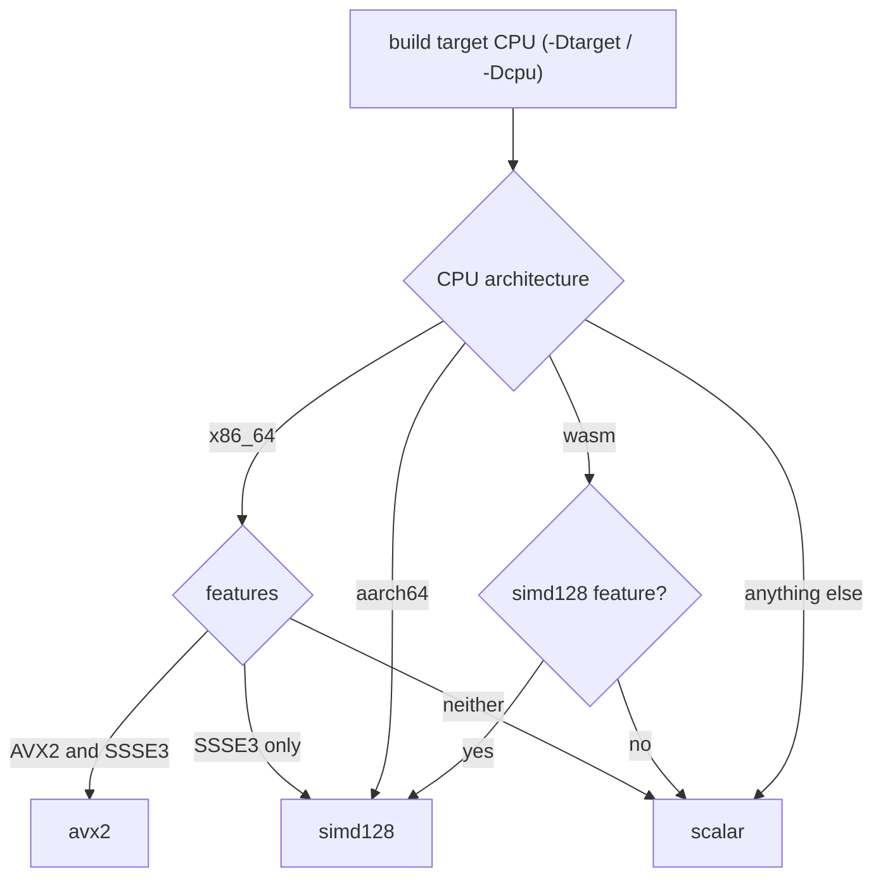
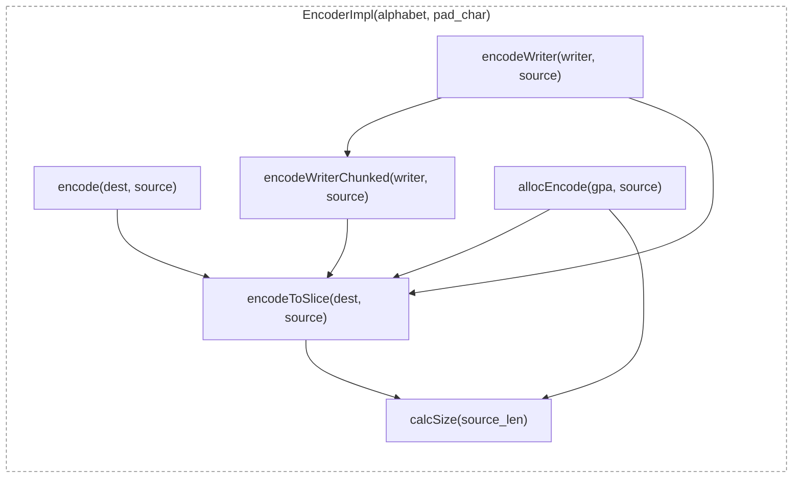
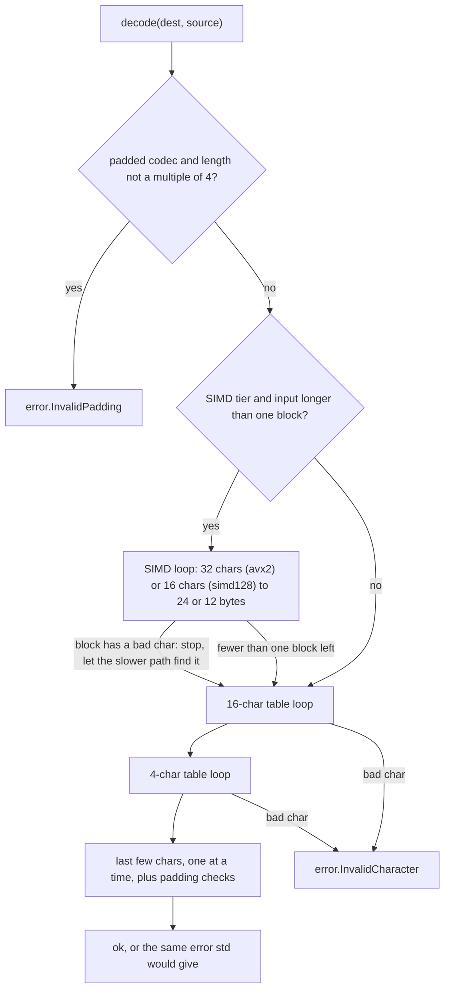

# base64

A Base64 encoder and decoder for Zig, written from scratch. It keeps the same API and the same errors as `std.base64`, and it's faster on most inputs, mainly on CPUs where it can use SIMD.

> **What is Base64?** A way to turn any bytes into plain text using 64 safe characters (`A-Z`, `a-z`, `0-9` and two more). It's how images end up inside JSON, how email carries attachments, and how many tokens are written. The rules are set by **RFC 4648**, the standard that defines Base64 and its variants.

Needs Zig 0.16.0 or newer. MIT licensed.

## Quick start

### Build and test

```sh
zig build test                      # runs all tests for your machine's CPU
zig build test -Dcpu=x86_64         # test the scalar tier
zig build test -Dcpu=x86_64_v2      # test the simd128 tier
zig build test -Dcpu=x86_64_v3      # test the avx2 tier
```

`-Dcpu` is explained in [How it picks a speed tier](#how-it-picks-a-speed-tier).

### Use it

Add the package to your project:

```sh
zig fetch --save git+https://github.com/Kbgjtn/base64
```

Then import the `base64` module in your `build.zig`:

```zig
const base64_dep = b.dependency("base64", .{ .target = target, .optimize = optimize });
exe.root_module.addImport("base64", base64_dep.module("base64"));
```

The codecs live under `.base64`:

```zig
const b64 = @import("base64").base64;
```

There are four ready-made codecs, the same four as `std.base64`:

| Codec | Characters 62 and 63 | Padding with `=` |
|---|---|---|
| `standard` | `+` `/` | yes |
| `standard_no_pad` | `+` `/` | no |
| `url_safe` | `-` `_` | yes |
| `url_safe_no_pad` | `-` `_` | no |

Use `url_safe` when the text goes into a URL or a filename, because `+` and `/` mean something there.

**Encode**

```zig
const input = "hello";
var buf: [64]u8 = undefined; // needs at least Encoder.calcSize(input.len) bytes
const encoded = b64.standard.Encoder.encode(&buf, input); // "aGVsbG8="
```

Other ways to encode:
- `encodeToSlice(dest, source)` returns the number of bytes written.
- `allocEncode(gpa, source)` allocates the output for you. You free it.
- `encodeWriter(writer, source)` streams to a `*std.Io.Writer`. Large inputs are written in 12 KiB pieces, so you never need a buffer for the whole output.

**Decode**

```zig
const text = "aGVsbG8=";
const len = try b64.standard.Decoder.calcSizeForSlice(text);
var out: [64]u8 = undefined;
try b64.standard.Decoder.decode(out[0..len], text); // "hello"
```

`dest` must be exactly `calcSizeForSlice(source)` bytes long, the same rule as std.

**Decode while skipping some characters**

Base64 in emails and PEM files (like TLS certificates) is split into lines. To skip the line breaks:

```zig
const d = b64.standard.decoderWithIgnore("\r\n");
var out: [256]u8 = undefined;
const n = try d.decode(&out, wrapped_text); // returns the decoded length
```

Here `dest` only needs to be at least `d.calcSizeUpperBound(source.len)` bytes. If it's too small you get `error.NoSpaceLeft`.

## Same API and errors as std.base64

The names and call shapes match `std.base64`: `standard.Encoder.encode(dest, src)`, `Decoder.calcSizeUpperBound`, `Decoder.calcSizeForSlice`, `Decoder.decode`, `decoderWithIgnore`, and the same error set:

| Error | When |
|---|---|
| `InvalidCharacter` | A byte that isn't in the alphabet (or `=` on a no-pad codec) |
| `InvalidPadding` | Wrong length, wrong number of `=`, data after `=`, or leftover bits that aren't zero |
| `NoSpaceLeft` | `decoderWithIgnore` only: the output buffer is too small |

**std is the test oracle.** "Oracle" means the trusted answer we check against. The tests run the same input through this library and through `std.base64` and require identical results:
- Encode: all four codecs, random input of every length from 0 to 1023 bytes.
- Decode: all four codecs, random input of every length from 0 to 299 bytes, both clean and with a random byte corrupted. The output must match std, and so must the error when there is one. On SIMD builds each case is also run at both SIMD widths (16 and 32) and with SIMD switched off.
- std's own test vectors and error cases, ported over.

One difference: in std, `standard` is a value of type `Codecs`. Here `standard` is a type. Calls like `standard.Encoder.encode(...)` work the same, but a function that takes a `std.base64.Codecs` parameter needs `comptime Codec: type` instead.

Two additions std doesn't have: `encodeToSlice` and `allocEncode`.

## How it picks a speed tier

**SIMD** ("single instruction, multiple data") means the CPU works on 16 or 32 bytes with one instruction instead of one byte at a time. Different CPUs support different SIMD instruction sets. On x86_64 the ones that matter here are **SSSE3** (16 bytes at a time) and **AVX2** (32 bytes at a time). Older or low-end CPUs may lack one or both.

The library has three versions of its hot loops, called tiers:

| Tier | Works on | Used when the target CPU has |
|---|---|---|
| `scalar` | 1 value at a time (plus lookup tables) | no supported SIMD |
| `simd128` | 16 bytes at a time | SSSE3 on x86_64, any aarch64 (NEON), wasm with `simd128` |
| `avx2` | 32 bytes at a time | AVX2 and SSSE3 on x86_64 |

The tier is picked **when you compile**, not when the program runs. Zig knows which CPU you are building for, so only one tier ends up in the binary. There's no runtime check and no cost per call. The build prints which tier it chose.

The catch: a binary only uses the features of the CPU it was built for. You choose that with `-Dcpu`:

| `-Dcpu` | Tier you get | Runs on |
|---|---|---|
| `native` (default) | Whatever your machine has | Your machine and ones like it |
| `x86_64` | `scalar` | Any x86_64 CPU |
| `x86_64_v2` | `simd128` | x86_64 CPUs with the v2 feature level (includes SSSE3) |
| `x86_64_v3` | `avx2` | x86_64 CPUs with the v3 feature level (includes AVX2) |

```sh
zig build -Doptimize=ReleaseFast -Dcpu=x86_64_v3
```

If you ship one binary for all x86_64 machines, you get `scalar`. Pick `x86_64_v2` or `x86_64_v3` only if every machine you deploy to supports it, otherwise the program will crash on older CPUs.



Only little-endian CPUs are supported (x86_64, aarch64 and wasm all are). Big-endian targets get a compile error.

## How it works

### Encoder

The alphabet and padding are fixed at compile time, so a no-pad codec has no padding code at all. Every encode path ends in `encodeToSlice`:



Where the speed comes from:
- **SIMD tiers:** 24 bytes in, 32 characters out per step on `avx2` (12 in, 16 out on `simd128`). Characters are produced with a few compares instead of a table lookup per character.
- **Scalar tier:** a 4096-entry table turns 12 bits into 2 characters at once, so it does half the lookups std does. The cost is 8 KiB of read-only data per codec you use.
- **Streaming:** `encodeWriter` calls the writer once per 12 KiB. std's calls it once per 3 input bytes.

### Decoder



- The SIMD loop checks a whole block at once. If any character in it is invalid, it stops and hands over to the non-SIMD path, which finds the exact error the same way std does. That's how errors stay identical to std.
- The SIMD loop sits in its own function and only runs when the input is longer than one block. On AVX2 this matters because leaving 256-bit code requires an instruction called `vzeroupper`, and on tiny inputs that cost showed up as the single biggest item in the profile. Short inputs now skip it entirely.
- The SIMD decoder only supports alphabets that start with `A-Za-z0-9` (true for all four built-in codecs). Custom alphabets use the non-SIMD path.

**Why `u12` and `u4` were slow.** Zig lets you use integers of any width, like `u12` (12 bits) or `u4`. The last-few-characters loop kept its bit buffer in a `u12` and its counter in a `u4`. The Zig compiler's backend (LLVM) kept those odd-width values in memory on the stack instead of in CPU registers, so every character paid for a write to memory and a read back. Switching them to `u32`, and masking the buffer to 12 bits by hand, keeps them in registers. That alone made `decoderWithIgnore` about 2.7 times faster on 1 MiB inputs.

## Performance

> Measured on one machine: AMD Ryzen 3 3300X, boost on, Linux, Zig 0.16.0, `ReleaseFast`, pinned to one core, median of 7 runs, at commit `cc3ddde`. Your numbers will differ on other CPUs.

Speedup means std's time divided by ours. Above 1× we're faster, below 1× std is.

### Large inputs (1 MiB)

Median across the five 1 MiB test inputs (random, text, zeros, sequential, Base64 text) and all four codecs. `decode_ignore` uses the `standard` codec only.

| Tier (`-Dcpu`) | Encode | Decode | Decode with ignore |
|---|---|---|---|
| scalar (`x86_64`) | **1.64×** (3.90 vs 2.38 GiB/s) | **1.00×** (2.78 vs 2.80 GiB/s) | **2.83×** (0.83 vs 0.29 GiB/s) |
| simd128 (`x86_64_v2`) | **2.40×** (5.70 vs 2.37 GiB/s) | **1.11×** (3.11 vs 2.79 GiB/s) | **2.70×** (0.79 vs 0.29 GiB/s) |
| avx2 (`x86_64_v3`) | **3.51×** (8.10 vs 2.31 GiB/s) | **2.06×** (5.75 vs 2.79 GiB/s) | **2.71×** (0.80 vs 0.29 GiB/s) |

At bigger sizes the SIMD tiers slow down a bit, because the data no longer fits in the CPU's cache (16 MiB on this CPU) and memory speed becomes the limit. At 64 MiB: avx2 encode 2.97×, decode 1.93×; simd128 encode 2.21×, decode 1.09×; scalar encode 1.60×, decode 0.99×.

### Small inputs (0 to 64 bytes)

Small inputs are measured in nanoseconds per call, across all four codecs.

| Tier | Encode | Decode | Decode with ignore |
|---|---|---|---|
| scalar | 1.26× to 2.50× | 1.07× to 2.32× | 1.72× to 3.00× |
| simd128 | 1.51× to 2.50× | 0.93× to 2.04× | 1.33× to 3.25× |
| avx2 | 0.80× to 3.00× | 1.17× to 2.02× | 1.64× to 3.27× |

- simd128 decode only drops below std at 13 B (0.98×), 16 B (0.93×) and 25 B (0.95×).
- avx2 encode only drops below std at 1 to 5 B. See [Known limits](#known-limits).

### Reproduce the numbers

```sh
python3 scripts/gen-corpus.py -o bench/corpus   # once: generate the test inputs
scripts/bench-tiers.sh                           # build and run each tier
python3 scripts/bench-summary.py bench/results > bench/results/SUMMARY.md
```

`bench-tiers.sh` needs Linux, `taskset` and Python 3. It builds the bench once per tier (`-Dcpu=x86_64`, `x86_64_v2`, `x86_64_v3`), pins it to one core and writes `bench/results/<tier>-<cpu>/bench.csv` plus `meta.txt` (CPU, governor, boost, Zig version, git revision). Settings via environment variables, for example `TIERS="x86_64_v3" RUNS=9 scripts/bench-tiers.sh`. `PERF=1` also records `perf` profiles.

For stable numbers: set the CPU governor to `performance`, close other programs, and commit first so `meta.txt` doesn't show a `-dirty` revision.

## Known limits

- **Rejecting short invalid input is slower than std on simd128 and avx2.** For payloads of about 13 to 49 bytes with bad padding or a bad character near the end, we're mostly 0.5 to 0.7× std's speed (a few sizes reach 0.8×). In absolute terms that's about 9 to 19 ns per rejected input against std's 5 to 11 ns. The scalar tier is closer: 0.86 to 0.90× at 31 to 49 bytes with bad padding. It only matters if you reject a lot of short garbage.
- **avx2 encoding of 1 to 5 bytes, mostly on the no-pad codecs, is 0.80 to 0.96× std.** That's under 1 ns per call.
- **Scalar-tier decode of large inputs is the same speed as std** (0.97 to 1.02×). Both run essentially the same loop. Encode on the scalar tier is still 1.6× faster.
- **No runtime CPU detection.** One binary uses one tier. A portable x86_64 build gets `scalar`.
- **Little-endian only.** Big-endian targets don't compile.

## Should you use this, or std.base64?

**Short answer: start with `std.base64`.** It ships with the compiler, works on every target, and for most programs Base64 is never the slow part. Switch when a profile shows Base64 is actually costing you time.

**This library helps if you:**
- Encode or decode a lot of data at once: uploads, attachments, MIME or PEM, data URIs, blobs in JSON, log pipelines.
- Build for a known CPU: servers, containers or CI built with `-Dcpu=x86_64_v2` or `x86_64_v3`, or aarch64.
- Stream large encodes to a writer.
- Decode line-wrapped input with `decoderWithIgnore` (about 2.7 to 2.8× faster on every tier).

**Stick with std if you:**
- Mostly handle short strings like tokens, IDs and headers. You'll save a few nanoseconds at best.
- Ship one portable x86_64 binary and mostly decode. The scalar tier decodes at std's speed.
- Reject a lot of short invalid input on a SIMD tier (see Known limits).
- Target a big-endian CPU.
- Pass `std.base64.Codecs` values around in your API.
- Need a long-term, reviewed dependency. This is a young, single-author project.

| Your situation | Pick |
|---|---|
| Not sure, or Base64 isn't in your profile | `std.base64` |
| Mostly short strings (under 64 B) | `std.base64` |
| One portable x86_64 binary, mostly decoding | `std.base64` |
| Big-endian target | `std.base64` |
| Large encodes or decodes on `x86_64_v2`, `x86_64_v3` or aarch64 | **this library** |
| Line-wrapped input (PEM, MIME) | **this library** |

Switching either way is mostly an import change, since the calls look the same.

## License

MIT. See [LICENSE](LICENSE).
